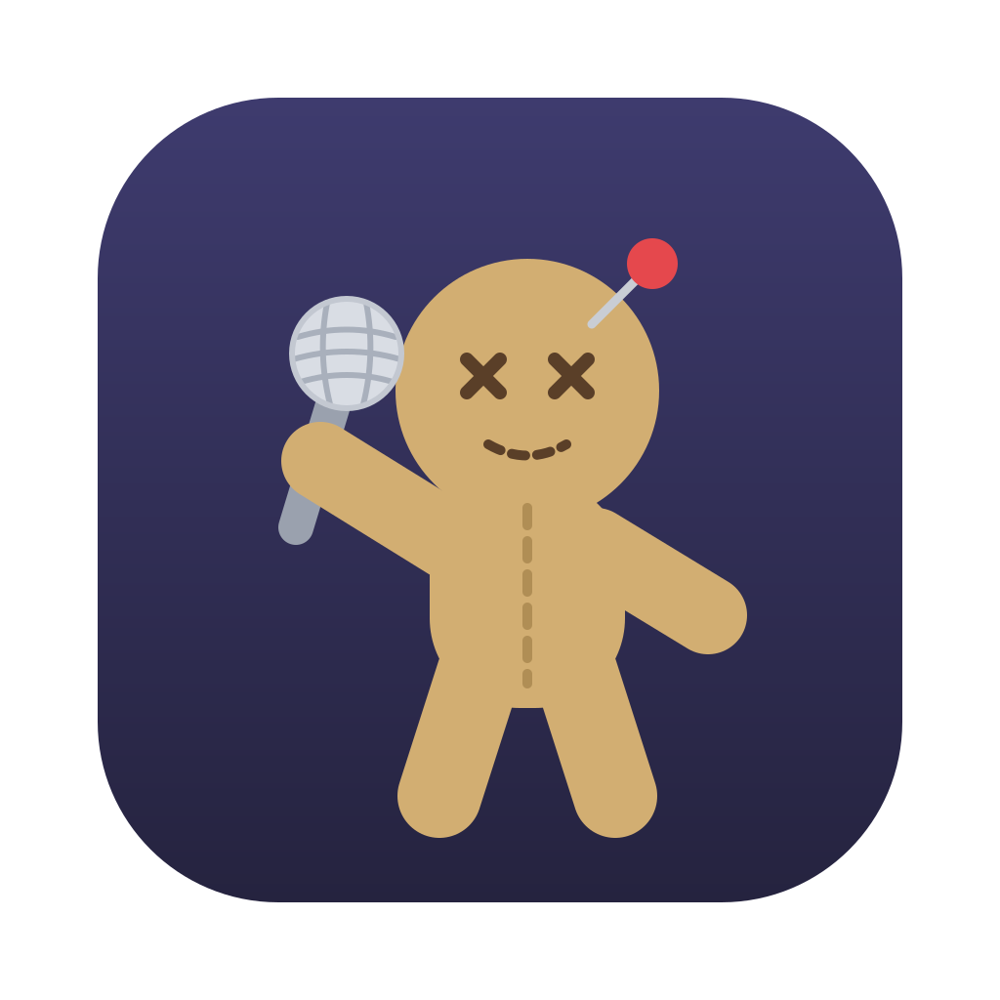

# VoodooHDA + Intel SOF DMIC (deneysel)

<p align="center"></p>

[English](README.md) | **Türkçe**

Bu [VoodooHDA](https://github.com/CloverHackyColor/VoodooHDA) fork'u, **yeni Intel laptopların dahili dijital mikrofonunu (DMIC)** macOS'ta (Hackintosh) çalıştırır.

Alder Lake ve diğer yeni Intel laptoplarda dahili mikrofonlar HDA ses kodeğine bağlı değildir. Ses DSP'sinin (Intel cAVS / Sound Open Firmware) arkasındadırlar. AppleALC ve normal VoodooHDA onları göremez, bu yüzden macOS'ta dahili mikrofon hiç yokmuş gibi görünür. Bu fork, Intel'in SOF firmware'ini VoodooHDA'nın içinden DSP üzerinde başlatır, DMIC hattını Linux'un yaptığı şekilde kurar ve mikrofonu normal bir CoreAudio giriş cihazı olarak yayınlar.

> **Durum: deneysel.** Tek bir makinede geliştirildi ve test edildi: **HP ProBook 440 G9 (Alder Lake-P, PCI 8086:51C8), macOS Tahoe 26.7**. Bu makinede Linux'takiyle aynı kalitede kayıt alıyor. Başka hiçbir şey test edilmedi. Bu bir çekirdek eklentisi (kext) olduğu için bir hata kernel panic'e yol açabilir. Geri dönebileceğiniz çalışan bir EFI/kext saklayın.

## Özellikler

- **Internal Microphone (Dahili Mikrofon)**: DMIC çifti, 48 kHz, 2 kanal, 16 bit. Sistem Ayarları'ndaki giriş seviyesi kaydırıcısı (−50…+20 dB, DSP kazancı) ve sessize alma çalışır.
- **Internal Microphone (Noise Reduction) / Dahili Mikrofon (Gürültü Azaltma)**: aynı akış üzerinde ikinci bir giriş cihazı. Sırasıyla 90 Hz yüksek geçiren filtre, [RNNoise](https://github.com/xiph/rnnoise) (çekirdekte çalışır, tek çekirdeğin yaklaşık %1–2'si) ve −1 dBFS limiter uygular. İki cihaz aynı anda kullanılabilir. Seviye ve sessize alma ikisinde eşli kalır.
- **SofMicBar**: canlı bir gürültü azaltma gücü kaydırıcısı (%0–100) ve sessize alma düğmesi olan menü çubuğu uygulaması (macOS'ta girişi sessize alma düğmesi yoktur). Oturum açılışında başlayabilir.
- **Boşta güç tasarrufu**: son kayıt bittikten 5 sn sonra DSP D0i3 uyku moduna geçer. Bir uygulama kayda başlayınca yaklaşık 7 ms'de uyanır.
- VoodooHDA'nın mevcut özellikleri (HDA kodek, hoparlör, kulaklık, jak mikrofonu) değişmedi. `-voodoosof` açılış parametresi olmadan SOF kodunun hiçbiri çalışmaz.

## Desteklenmeyenler / bilinen sorunlar

- **Uyku/uyanma test edilmedi.** Test makinesi uyku kapalı çalışıyor. S3 uykusundan sonra DSP'nin büyük ihtimalle firmware'i yeniden yüklemesi gerekir. Bu henüz yazılmadı.
- **Başka laptoplar**: DMIC ayarları, test makinesinde Linux'tan alınan bir kayıttan tekrar oynatılıyor. Kendi kaydınızı nasıl alacağınız için [sof/README.tr.md](sof/README.tr.md) dosyasına bakın.
- Soğuk başlangıçta kaydın ilk ~15–70 ms'si DMIC ısınırken sessiz gelir.
- `tranc/` içindeki Xcode projeleri güncellenmedi. `build-kext.sh` ile derleyin.

## Gereksinimler

- cAVS DSP'si açık bir Intel HDA denetleyicisi. PCI cihaz kimliği `kSofDeviceIds` (`tranc/VoodooHDASof.cpp`) listesinde olmalı. Şu an yalnızca `0x51C8` var.
- DSP'yi görünür bırakan bir firmware/BIOS. Makinenizde Linux ses için `snd_sof_pci_intel_tgl` kullanıyorsa DSP görünür demektir.
- Derlemek için Xcode Command Line Tools (`xcode-select --install`). Xcode'un kendisi gerekmez.

## Derleme

```sh
./build-kext.sh                 # -> build/VoodooHDA.kext (cihaz adları İngilizce)
SOF_LANG=tr ./build-kext.sh     # Türkçe cihaz adları ("Dahili Mikrofon")
tools/SofMicBar/build.sh        # -> tools/SofMicBar/build/SofMicBar.app
```

Firmware ve IPC tekrar verisi `sof/` klasöründedir. Derleme sırasında `sof/SHA256SUMS` ile doğrulanırlar.

## Kurulum

**Başlamadan önce** mevcut `VoodooHDA.kext` ve EFI'nizin bir kopyasını saklayın.

1. Kext'i şu iki yoldan biriyle kurun:
   - **OpenCore (olağan yol):** `EFI/OC/Kexts/VoodooHDA.kext` dosyasını `build/VoodooHDA.kext` ile değiştirin. `config.plist` dosyasında, normal VoodooHDA'da olduğu gibi, onun için bir `Kernel → Add` kaydı bulunduğundan emin olun.
   - **/Library/Extensions:** `sudo bash install/install-kext.sh` çalıştırın. Eski kext'i `~/VoodooHDA-backup/` klasörüne yedekler.
2. `boot-args` değerine **`-voodoosof`** ekleyin (`NVRAM → Add → 7C436110-AB2A-4BBB-A880-FE41995C9F82 → boot-args`) ve yeniden başlatın.
3. İsteğe bağlı: menü çubuğu uygulaması için `sudo bash install/install-sofmicbar.sh` çalıştırın, sonra uygulamanın menüsünden "Açılışta başlat"ı açın. Uygulama sistem dilini izler (Türkçe veya İngilizce). Dili zorlamak için `defaults write local.voodoohda.sofmicbar language tr` (veya `en`) çalıştırıp uygulamayı yeniden başlatın.

Geri almak için `-voodoosof` parametresini silin. VoodooHDA o zaman yeniden normal haliyle çalışır.

### Açılış parametreleri

| boot-arg | Etkisi |
|---|---|
| `-voodoosof` | SOF/DMIC desteğini açar (zorunlu) |
| `voodoosofnr=0\|1\|2` | gürültü azaltmalı ikinci cihaz: kapalı / açık, %50 (varsayılan) / açık, %100 |
| `voodoosofpm=0` | DSP'yi boştayken tamamen açık tutar (D0i3 yok) |
| `-voodoosofdbg` | ayrıntılı log (register dökümleri, her IPC) |
| `voodoosofstep=1..4` | yalnızca hata ayıklama için: probe / ROM init / firmware açılışı / IPC adımından sonra durur |

### Çalıştığını kontrol etmek

```sh
kextstat | grep VoodooHDA
/usr/bin/log show --last boot --predicate 'eventMessage CONTAINS "VoodooHDA SOF"' --style compact
```

Normal bir açılış yaklaşık on satır log yazar: `enabled`, `FW_READY: version 2.2.0 …`, `firmware boot complete`, `ready`, `capture engine published` ve birkaç saniye sonra `DSP idle: D0i3`.

`tools/sof-test/` klasöründe iki küçük komut satırı aracı var: `rec` bir cihazdan kayıt alıp seviyesini yazar, `sofctl` sessize almayı ve gürültü azaltma gücünü okur veya ayarlar.

## Nasıl çalışıyor (kısaca)

1. VoodooHDA başlarken `VoodooHDASof` DSP BAR'ını eşler. Sonra Linux'un `hda_dsp_cl_boot_firmware_iccmax()` sırasını izler: core 0'ı açar, ROM init'i çalıştırır, imzalı firmware'i HDA kod yükleyici DMA'sı üzerinden gönderir ve `FW_READY` (IPC3) mesajını bekler.
2. Linux'un `sof-hda-generic-2ch.tplg` için gönderdiği IPC3 mesajlarını tekrar oynatır: pipeline, ses seviyesi bileşeni ve DMIC DAI ayarı.
3. `VoodooHDASofEngine` (bir `IOAudioEngine`) örnekleri doğrudan DMIC host DMA halkasından alır. Konumlar yoklanarak (polling) okunur, kesme kullanılmaz. Böylece VoodooHDA'nın kesme yoluna dokunulmaz. Gürültü azaltmalı motor RNNoise'u `convertInputSamples` içinde çalıştırır.
4. Boştayken D0I3C register'ına yazar ve compact `PM_GATE` IPC'si gönderir. Bu, `hda_dsp_set_D0_state()` ile aynı sıradır.

Register düzeni ve sıralar Linux SOF sürücüsünden (`sound/soc/sof/intel/`) uyarlandı. Kaynak koddaki yorumlar her parçanın hangi Linux fonksiyonundan geldiğini belirtir.

## Lisanslar ve emeği geçenler

- **VoodooHDA**: BSD 2-Clause, bkz. [LICENSE](LICENSE) ve [README-VoodooHDA.md](README-VoodooHDA.md). © CloverHackyColor, Slice ve VoodooHDA yazarları.
- **SOF desteği** (`tranc/VoodooHDASof*`): BSD 3-Clause. Linux SOF Intel sürücüsünden uyarlandı. O sürücünün SOF kısımları GPL-2.0-only VEYA BSD-3-Clause olarak çift lisanslıdır, © Intel Corporation. Burada BSD-3-Clause seçeneği kullanıldı.
- **SOF firmware** (`sof/firmware/sof-adl.ri`): [thesofproject/sof-bin](https://github.com/thesofproject/sof-bin) deposundan değiştirilmemiş ikili dosya, © Intel Corporation ve diğerleri. Bkz. [sof/firmware/LICENCE.Intel](sof/firmware/LICENCE.Intel).
- **RNNoise** v0.1.1 (`tranc/rnnoise/`): BSD 3-Clause, © Xiph.Org Foundation, Mozilla, Jean-Marc Valin. Bkz. [tranc/rnnoise/COPYING](tranc/rnnoise/COPYING). Çekirdekte çalışacak şekilde uyarlandı, bkz. [README.voodoo](tranc/rnnoise/README.voodoo).

Yukarıdaki lisanslarda belirtildiği gibi HİÇBİR GARANTİ yoktur. Intel, HP ve Apple sahiplerinin ticari markalarıdır. Bu proje hiçbiriyle bağlantılı değildir.
